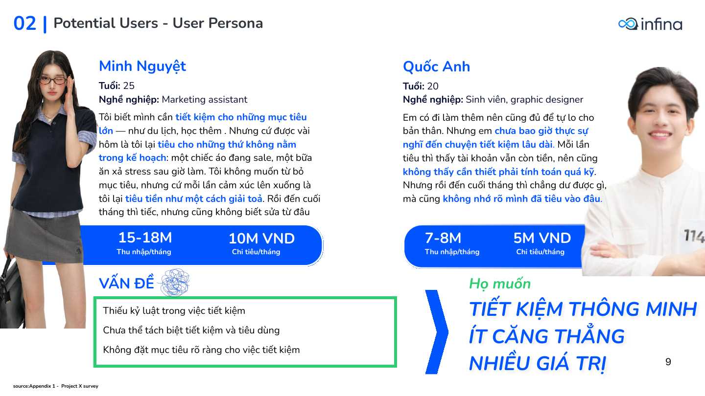
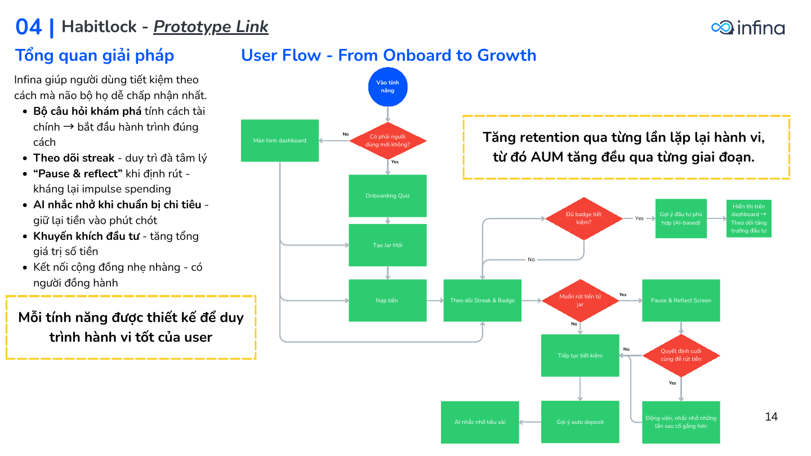
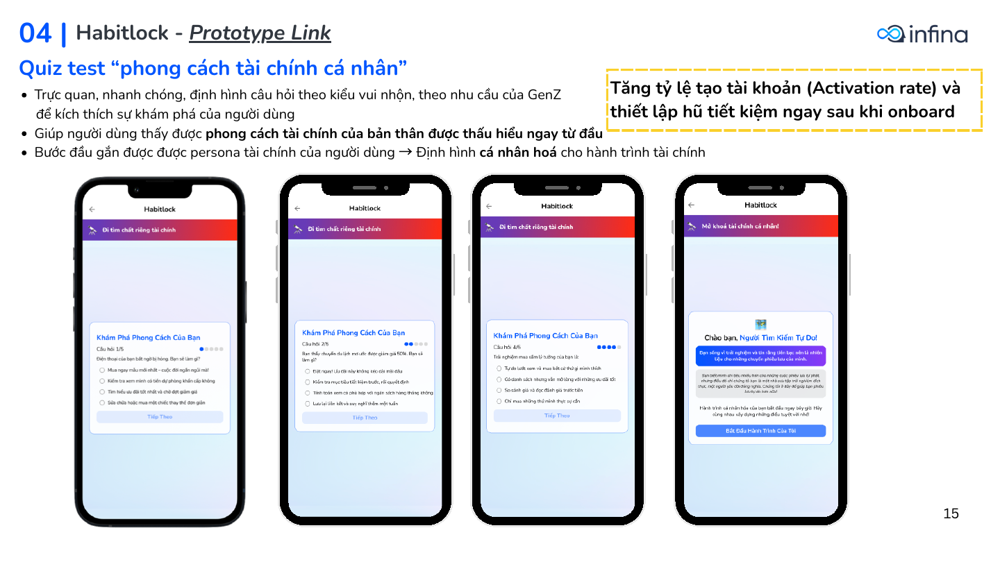
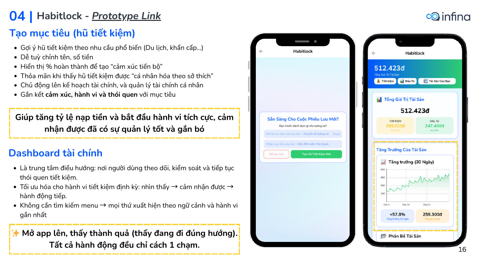
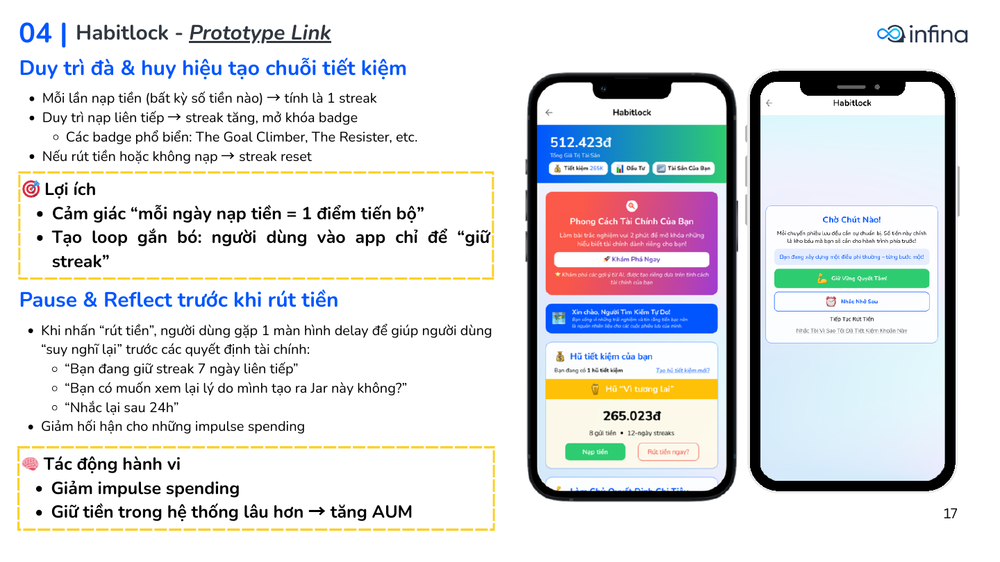
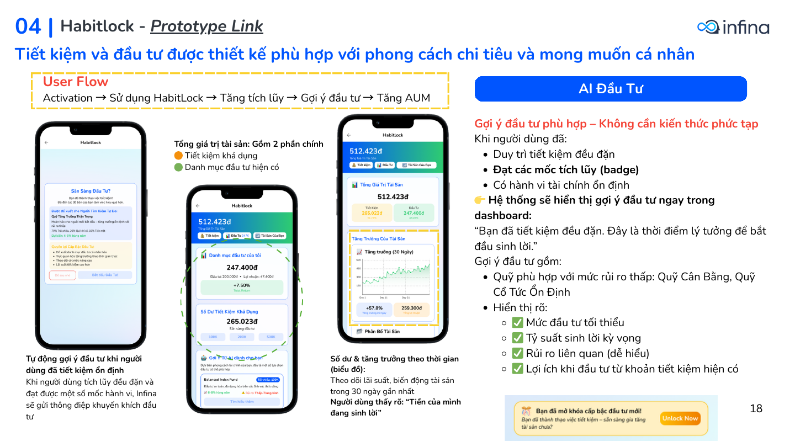
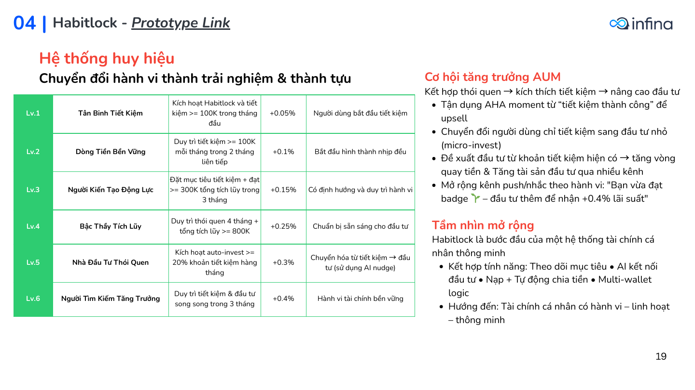

# Habitlock: helping young Vietnamese save consistently without pressure

> Product-management case study for **Infina** (embedded fintech savings app) · Final round of the *"Heading for the future: Product Management"* challenge, 2025 · Team **Project X**

**Team:** Bùi Nguyễn Linh Anh · Trần Ngọc Linh · Nguyễn Đức Phi Long · Nguyễn Hà Minh Anh
<!-- Add your prototype link here, then delete the comment markers:
**Prototype:** https://... -->
**Full proposal (Vietnamese):** [`docs/Habitlock_Infina_Final_Round_Proposal.pdf`](docs/Habitlock_Infina_Final_Round_Proposal.pdf)

> **Status:** proposal and prototype. Every number in the "Targets" sections is a plan, not a measured result. Nothing here was shipped.

**TL;DR**
- **Problem:** 18–25s in Vietnam want to save but give up when spending temptation hits (>70% of survey respondents name impulsive spending as the biggest barrier; survey sample size is not stated in the proposal).
- **Solution:** Habitlock, a habit layer on Infina's yield wallet: goal jars, streaks and badges, and a Pause & Reflect step before withdrawals.
- **Outcome:** Finalist, *Heading for the Future: Product Management* 2025 (Infina).
- **After the competition I added:** a financial model, a metrics framework with guardrails and experiments, an insight-to-metric traceability table, and a self-critique. On illustrative assumptions the model shows the idea does not pay for itself as a paid-acquisition play, and identifies what would have to be true for it to work.
- **My contribution:** [WRITE THIS YOURSELF: which parts you did in the team of 4, in one or two specific lines]

---

## 1. The question

*How can Infina help 18–25-year-olds build a steady saving habit, without making saving feel like pressure?*

## 2. Market and opportunity

- Vietnam's fintech market is growing fast (IMARC projects a 14.2% CAGR to 2033), and McKinsey sizes the wealth market at about US$600B by 2027.
- Young people already use digital wallets for saving (61% of Gen Z per Statista), but 32–33% struggle to build savings or manage investments.
- **Sizing used in the proposal:** about 17M people aged 18–25 → about 7M interested in personal finance → about 3M ready to save with the right tool. Converting 20–30% of that 3M would add 600K–900K users to Infina's existing base.

## 3. Competitive gap

| Player | Strength | Gap |
|---|---|---|
| MoMo (Túi Thần Tài) | Wallet-integrated, cashback | Does not separate saving from spending |
| Tikop | Micro-invest, gamification | Complex UX, overwhelming for newcomers |
| Techcombank | Convenient transfers | Limited automatic-interest tiers |
| Timo | Spending jars, streak-based saving | No automatic yield |

**Opportunity:** existing products solve "make idle money earn interest" but not "how do I actually build a good habit". Infina can differentiate through behaviour design: a companion tool, a yield wallet separate from the spending wallet, and habit-building mechanics.

## 4. Who it is for

| Segment | Age | Behaviour | Priority |
|---|---|---|---|
| Steady Savers | 25–35 | Already save actively and plan spending | n/a |
| **Emerging Savers** | 20–25 | Save only "if something is left", give up easily, withdraw on impulse | **Primary** |
| Financial Newcomers | 18–20 | Students living on allowance, little financial knowledge | Secondary |



## 5. Problems found (Project X survey)

| Issue | Evidence from the survey |
|---|---|
| Don't know how to start a personal financial plan | Only about 10% actively look for personal-finance information; about 30% understand the long-term benefits |
| Can't sustain the habit without concrete goals and discipline | About 50% have no clear goal; >70% name impulsive spending as the biggest barrier; only about 30% have a plan |
| Gap between theory and daily practice | >60% find applying theory hard; only about 5% feel they can apply it easily |
| Demand for a behaviour-aware tool | 85% want to understand their own financial behaviour; 88% want a reminder when spending emotionally |

**Strategic approach:** give users a personalised financial practice space, shaped by their emotions, behaviour and circumstances, that corrects habit-breaking behaviours and builds toward investing and financial freedom.

## 6. Solution: Habitlock

Onboarding quiz → savings jars → dashboard → streaks and badges → **Pause & Reflect** before withdrawals → AI nudges and investment suggestions → auto-invest.
Details, user flow and the six-level badge system: [`docs/solution_habitlock.md`](docs/solution_habitlock.md)

| | |
|---|---|
|  |  |
|  |  |
|  |  |

## 7. Targets, roadmap and go-to-market (plan, Jul–Dec 2025)

| Metric | Jul | Dec | Definition |
|---|---|---|---|
| Active-Trust Flow Ratio | 65% | 78% | (savings + investment deposits) / withdrawals to bank |
| Adherence Rate | 5% | 50% | 1 − impulsive withdrawals / savings withdrawals |
| AI Suggestion Acceptance | 12% | 20% | AI-suggested orders placed / AI suggestions shown |
| Target-audience acquisition | 30% | 45% | TA users acquired / reachable TA |

Month-by-month targets, roadmap Gantt and the three-phase GTM: [`docs/metrics_roadmap_gtm.md`](docs/metrics_roadmap_gtm.md). Several of these KPI definitions have problems (e.g. a flow ratio below 100% even at target); see [`docs/metrics_framework.md`](docs/metrics_framework.md) §4 and [`docs/self_critique.md`](docs/self_critique.md).

## 8. Limitations and assumptions

- Survey sample size and sampling method are not stated in the deck; percentages are rounded.
- Market-sizing figures (17M → 7M → 3M) are top-down estimates, and the 20–30% conversion rate is an assumption.
- KPI baselines and targets are projections; no A/B test or live data supports them.
- Bonus-interest levels per badge are illustrative and would need Infina's unit-economics validation.

## 9. Post-competition extensions (my own work, after the final round)

| Document | What it shows |
|---|---|
| [`model/habitlock_financial_model.xlsx`](model/habitlock_financial_model.xlsx) | 18-month unit-economics model, 3 scenarios, bonus-interest sensitivity |
| [`docs/unit_economics_findings.md`](docs/unit_economics_findings.md) | What the model says and what would change the conclusion |
| [`docs/metrics_framework.md`](docs/metrics_framework.md) | North Star, input metrics, guardrails, 3 experiment designs, KPI fixes |
| [`docs/insight_to_metric_traceability.md`](docs/insight_to_metric_traceability.md) | Survey insight → feature → metric, with evidence strength |
| [`docs/compliance_notes.md`](docs/compliance_notes.md) | Regulatory questions for a real launch (to verify, not legal advice) |
| [`docs/self_critique.md`](docs/self_critique.md) | Internal inconsistencies in the original proposal and next steps |

## 10. Repository structure

```
├── README.md
├── model/
│   ├── habitlock_financial_model.xlsx
│   └── README.md
├── docs/
│   ├── Habitlock_Infina_Final_Round_Proposal.pdf   # original proposal (Vietnamese)
│   ├── solution_habitlock.md
│   ├── metrics_roadmap_gtm.md
│   ├── metrics_framework.md
│   ├── insight_to_metric_traceability.md
│   ├── unit_economics_findings.md
│   ├── compliance_notes.md
│   ├── self_critique.md
│   └── references.md
├── data/kpi_targets.csv
└── assets/slides/                                   # key prototype slides
```

## Notice

© 2025 Project X team. Shared for portfolio purposes only; please do not reuse commercially. Infina, MoMo, Tikop, Techcombank and Timo names, logos and screenshots belong to their owners.
