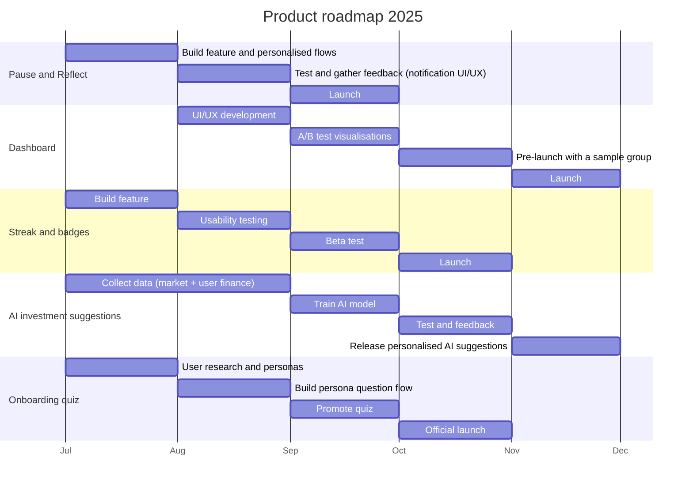

# Success metrics, roadmap and go-to-market

> All numbers below are **targets and plans from the proposal (Jul–Dec 2025), not measured results.**

## KPI targets

| Metric | Jul | Aug | Sep | Oct | Nov | Dec |
|---|---|---|---|---|---|---|
| Active-Trust Flow Ratio | 65% | 68% | 71% | 74% | 76% | 78% |
| Adherence Rate | 5% | 10% | 20% | 35% | 42% | 50% |
| AI Suggestion Acceptance Rate | 12% | 13% | 15% | 17% | 19% | 20% |
| TA Acquisition Rate | 30% | 31% | 33% | 38% | 42% | 45% |

Definitions are in [`../data/kpi_targets.csv`](../data/kpi_targets.csv). Known issues with these KPI definitions, and proposed fixes, are in [`metrics_framework.md`](metrics_framework.md) §4. Expectation stated in the proposal: active users peak in Sep–Oct; Nov–Dec may slow as users tend to withdraw money at year end.
Phases: Jul–Aug *Dev + Test*, Sep–Oct *Beta + Pre-launch*, Nov–Dec *Launch + Sustain*.

## Roadmap (approximate transcription of the roadmap slide)

## Go-to-market (6 months, 3 phases)

| Phase | Months | Product goal | Key features | Signals to track |
|---|---|---|---|---|
| 1. Foundation & Activation | Jul–Aug | Users understand and start using Habitlock early | Persona quiz, easy setup, Lv.1 badge + small bonus interest, first-week streak reminders | Quiz completion, Habitlock activation in 7 days, ≥2 deposits in 14 days, post-onboarding drop-off |
| 2. Habit Formation & Emotional Triggers | Sep–Oct | Sustain streaks, reduce emotional withdrawals | Streak tracking and rewards, badge levels, Pause & Reflect, light social loop | Weekly Habitlock retention (W1→W6), badge rate, withdrawal reasons, 30–60 day retention |
| 3. AI Recommendations & Retention | Nov–Dec | Turn savers into small investors, grow AUM | AI suggestions based on persona and history, unlock funds by level, auto-invest 10–20% | Investment within 7 days of Lv.4, auto-invest activation, AUM of Habitlock users, savings retained >60 days |
