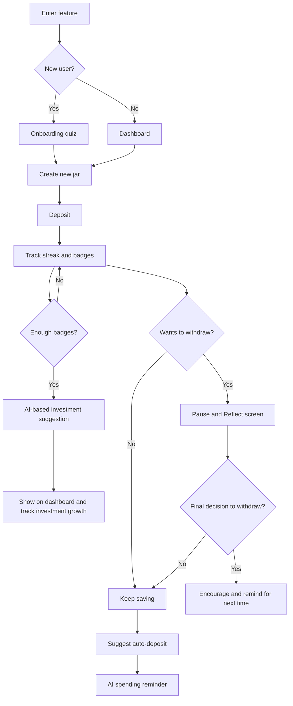

# Habitlock: solution design

Habitlock is a proposed behavioural-savings feature set for Infina's high-yield savings app. Its goal is to turn "pay yourself first" into an automatic, low-pressure habit.

## Feature set

| Feature | Behavioural purpose | Metric it should move |
|---|---|---|
| **Onboarding quiz** ("financial personality") | Personalise the journey from minute one; make users feel understood | Activation rate, jar-creation rate |
| **Savings jars** (goal-based) | Link saving to a concrete, emotional goal; show % progress | Deposit rate |
| **Dashboard** | One-glance view of savings vs investments and 30-day growth ("see → feel → act") | Return visits, retention |
| **Streaks & badges** | Any deposit counts as a streak; consistency unlocks levels and bonus interest | Weekly retention, deposit frequency |
| **Pause & Reflect** | Friction screen before a withdrawal (streak reminder, reminder of the jar's purpose, "remind me in 24h") | Adherence rate, AUM retained |
| **AI spending nudge** | Reminder when the user is about to spend impulsively | Adherence rate |
| **AI investment suggestions** | Low-risk fund suggestions (e.g. balanced, stable-dividend) once saving behaviour is stable | AI acceptance rate, AUM |
| **Auto-invest** | Move 10–20% of savings into funds automatically | AUM from Habitlock users |
| **Light community** | Compare streaks with similar users | Retention |

## User flow (from onboarding to growth)

## Badge system (as proposed)

| Level | Name | Unlock condition | Bonus interest | Meaning |
|---|---|---|---|---|
| 1 | Tân Binh Tiết Kiệm (Saving Rookie) | Activate Habitlock and save ≥ 100K VND in month 1 | +0.05% | Starts saving |
| 2 | Dòng Tiền Bền Vững (Steady Cash Flow) | Save ≥ 100K each month for 2 consecutive months | +0.10% | A rhythm forms |
| 3 | Người Kiến Tạo Động Lực (Motivation Builder) | Set a goal and reach ≥ 300K cumulative in 3 months | +0.15% | Direction + consistency |
| 4 | Bậc Thầy Tích Lũy (Accumulation Master) | 4 months of habit and ≥ 800K total | +0.25% | Ready to invest |
| 5 | Nhà Đầu Tư Thói Quen (Habit Investor) | Auto-invest ≥ 20% of monthly savings | +0.30% | Saving → investing (AI nudge) |
| 6 | Người Tìm Kiếm Tăng Trưởng (Growth Seeker) | Save and invest in parallel for 3 months | +0.40% | Sustainable financial behaviour |

## Why this design

- Survey findings (Project X survey) point to emotion-driven spending, not lack of income, as the main barrier: >70% cite impulsive spending as the biggest obstacle to staying consistent.
- Competitors solve "idle money earns interest" but not "how do I build a good habit": MoMo does not separate saving from spending, Tikop's UX overloads newcomers, Timo has habit mechanics but no automatic yield, Techcombank's automatic-interest tiers are limited.
- Infina's opening: a separate yield wallet plus behaviour-building mechanics (see [`../README.md`](../README.md)).
